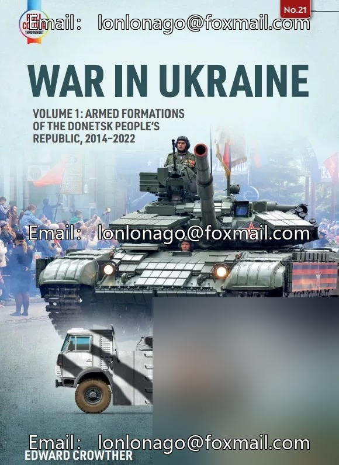
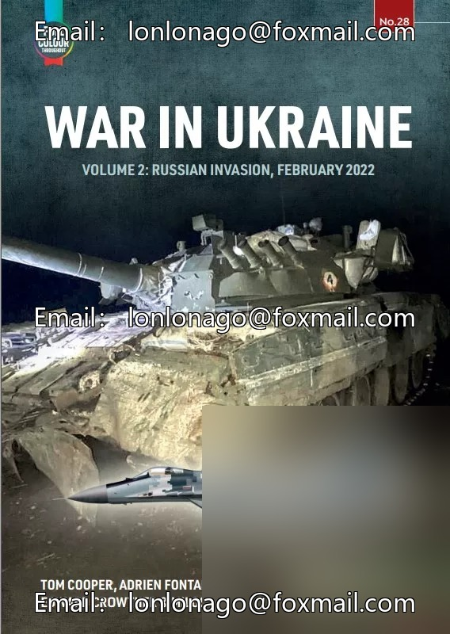
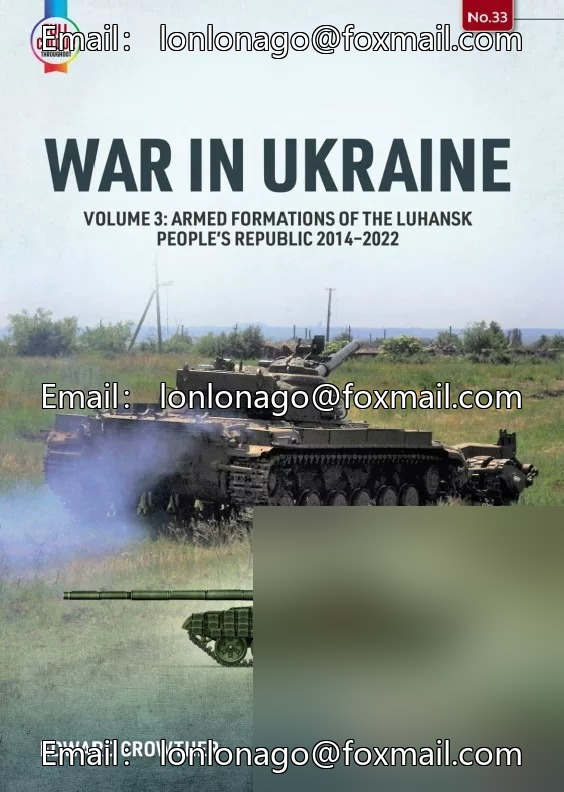
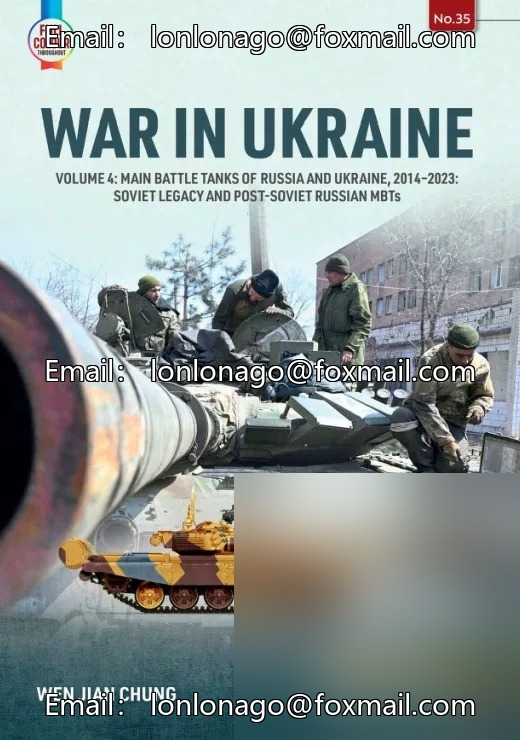
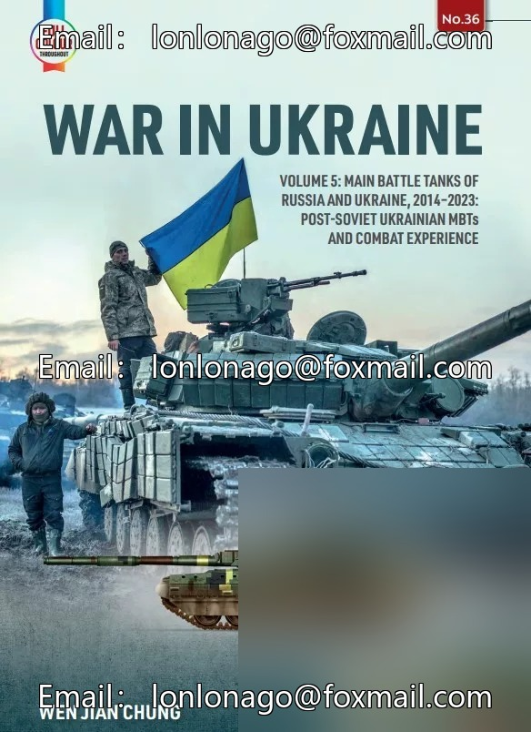
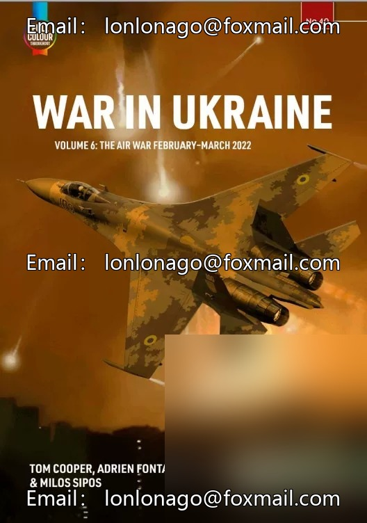

# [Electronic Collected Books—Russian-Ukrainian War Series]

## Body

Translate into English.
[E-books for Reserved Edition—Series of Warfare Between Russia and Ukraine]
Series of Wars between Ukraine and Russia 1-6 volumes complete
Volume 1: Armed Forces of the People's Republic of Donetsk
Focusing on the rise of pro-Russia militias in the 2014 Donbas conflict, analyzing their initial light equipment warfare and later process of integrating Russian heavy weapons, revealing the coordination relationship between local armed forces and Russia
​Volume 2: Russian Invasion
Recording the Russian military's "flash attack" failure in multiple fronts attacking Kiev and Harkovka, analyzing the strategic setback caused by intelligence errors and logistics collapse, with Ukraine's cities-based guerrilla warfare exploiting the situation to reverse the situation

1. Sort out the eight-year evolution of the Litovsk separatist forces, from civil dissent to institutionalized military power, and explore their cooperation with the Russian military in warfare and the 2022 campaign for full control over the state.
2. Volume 4: Russian-Ukraine main combat tanks (2014-2023)
3. Compare the upward upgrade dilemmas of the Russian military's T-72B3/T-90M and the Ukraine military's T-64BV refurbishment strategies, and analyze the differences of Soviet-era tanks in modernization, protection deficiencies, and practical loss.
4. Volume 5: Ukraine main combat tanks and operational experience
5. Elaborate on the technical breakthroughs of the Ukrainian military's self-developed Blunt and Oplot tanks, including the effectiveness of 125mm ammunition and the practical assessment of explosive protection armor.
6. Volume 6: Air War (Feb-Mar 2022)

Fatal blunder of exposing the Russian Air and Space Force's first month failing to destroy the U.S. air defense system; the U.S. military used TB-2 drones and remaining fighters to counterbalance the low-altitude raid by Russian aircraft.

The Russian-Ukraine war series includes six volumes covering various stages such as military forces, combat methods and combat experience; the image shows detailed sections, themes and author information.

<!-- AI_ENRICHED -->

## Images

## Payment

Here is a pay link on Stripe ( https://buy.stripe.com/3cs8yP7sY87d0vu9AB ). Please contact me lonlonago@foxmail.com after funding $89, and I will send you a complete data files , thank you!

